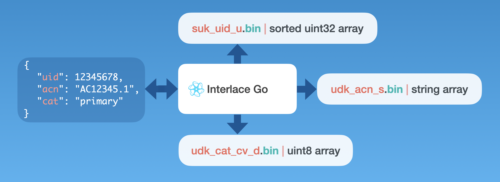

###### September 11, 2026: interlace-go readme v17

# interlace-go

At Quantome, we can govern data differently by keeping our data assets free from infrastructure bloat, archaic standards, and vendor lock-in. To honor these principles, we are sharing our ultralight Go library for free and staying committed to keeping it thin.



## Contents

1) [Introduction](#1-introduction)
2) [Installation](#2-installation)
3) [Test](#3-test)
4) [Usage](#4-usage)
5) [License](#5-license)

### 1. Introduction

A database is a transient tool and can be treated as a disposable secondary store. True independence from vendor lock-in requires data products built for additive schema evolution, free of infrastructure bloat, and liberated from archaic standards.

The **interlace-go** library helps innovators refine data and consolidate it into a ready state for any downstream tool, like pluripotent stem cells. It ingests and synthesizes disparate datasets into immutable, vertically partitioned, strongly typed binary arrays. This parallel substrate enables seamless, additive schema evolution while maintaining absolute data integrity and agile streaming fluidity. [PKG] gives a brief overview of these details.

The Interlace Go packages enable you to program command-line tools for high-speed information processing and querying, piping deterministic data directly into downstream tools such as LLMs, edge computing systems, bioinformatics pipelines, and standard Linux workflows.

### 2. Installation

Create your codebase, initialize Git, and add the **interlace-go** package as a dependency. We organize our repositories as follows, and it is not a requirement:

```text
YourGoCodeBaseName
├── .gitignore
├── LICENSE
├── README.md
├── cmd
│   ├── YourGoAppName1
│   │   └── main.go
│   └── YourGoAppName2
│       └── main.go
├── go.mod
├── go.sum
└── internal
   ├── app
   │   ├── YourGoAppName1
   │   │   ├── YourGoAppName1.go
   │   │   └── YourGoAppName1_test.go
   │   └── YourGoAppName2
   │       ├── YourGoAppName1.go
   │       └── YourGoAppName1_test.go
   └── pkg
       ├── README.md
       ├── YourPkgName
       │   ├── YourPkgName.go
       │   └── YourPkgName_test.go
       └── YourPkg2
           ├── YourPkg2.go
           └── YourPkg2_test.go
```

Move into `YourGoCodeBaseName` directory, turn it into a Git repository, and initialize your Go modules where `YourGoModuleName` may look like: `github.com/my-project/interlace-go`.

```shell
cd YourGoCodeBaseName
git init
go mod init YourGoModuleName
```

You can reference **interlace-go** in a Go program with import as follows:

```text
import "github.com/sas-quantome/interlace-go"
```

Or, you can explicitly get the package into `YourGoCodeBaseName`:

```shell
cd YourGoCodeBaseName
go get github.com/sas-quantome/interlace-go
```

### 3. Test

To test **interlace-go**, you must first clone the **interlace-go** repository and then run make.

```shell
git clone https://github.com/sas-quantome/interlace-go.git
```

The above command should create the `interlace-go` directory in your local machine. The Makefile inside provides the following targets for testing:

```text
test                           Run tests
coverage                       Run coverage report
vet                            Run code issues detection
clean                          Remove the bin folder and test files
```

Start with `test` and finish with `clean`. Example running make:

```shell
cd interlace-go
make test
```

### 4. Usage

The following GitHub repositories demonstrate how to use the **interlace-go** library.

#### 4.1 [interlace-ex](https://github.com/sas-quantome/interlace-ex)

Learn how to code and build a data stack with the **interlace-ex** command-line examples. This open-source educational repository guides you through consolidating human gene data, including products, interactants, genetic variants, and diseases, as a hands-on data refinement exercise. 15 Go programs are offered as starting models for creating robust datasets. The ensemble of these Go programs creates one **Interlace Entity**, named *Gene*, and 14 *Gene* **Interlace Assets**.

#### 4.2 [interlace-do](https://github.com/sas-quantome/interlace-do)

Once you have built the *Gene* data stack, you can use the **interlace-do** toolset to learn how to search and retrieve data from any **Interlace Asset**. This repository provides more than 40 command-line examples to help you do your own *Gene* queries.

### 5. License

This project is licensed under the Apache License Version 2.0 – see the [LICENSE](LICENSE) file for details.

[PKG]: https://github.com/sas-quantome/interlace-go/tree/main/pkg/#PKG
