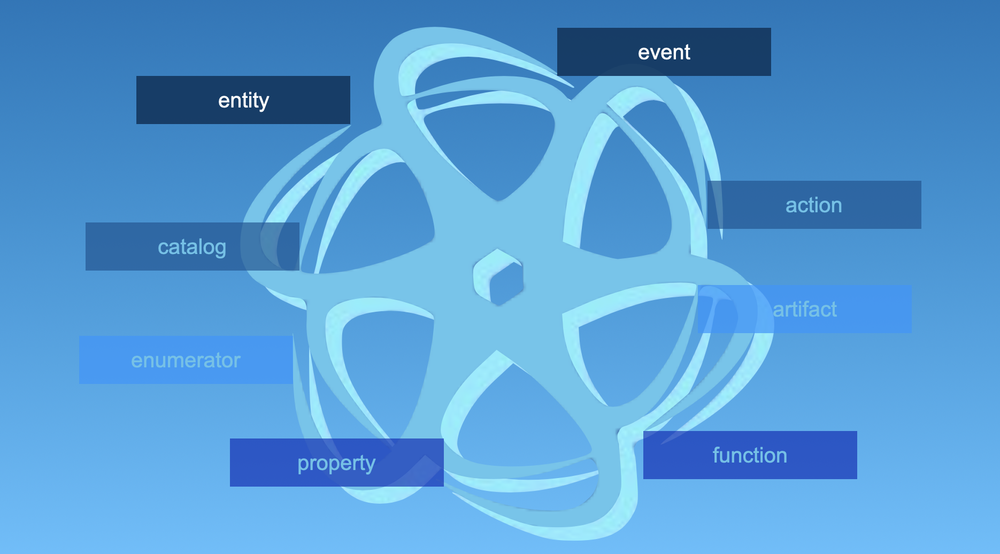
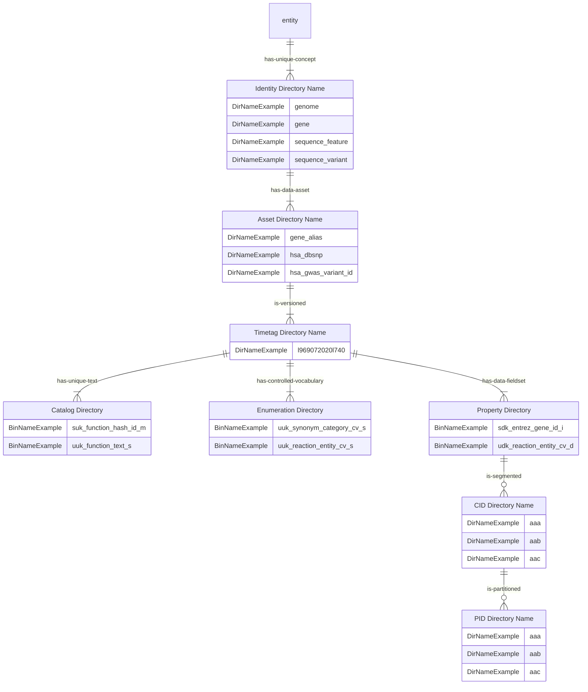
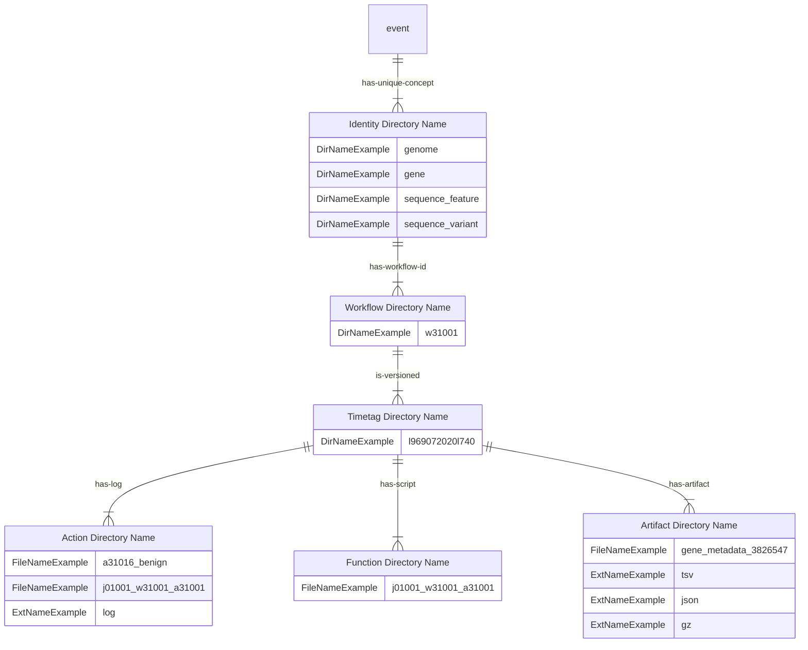

###### September 3, 2026: interlace-go pkg readme v9

# PKG



## Contents

1) [Contractor](#1-contractor)
2) [Cowriter](#2-cowriter)
3) [Extractor](#3-extractor)
4) [Randommer](#4-randommer)
5) [Runner](#5-runner)
6) [Storekeeper](#6-storekeeper)
7) [Tester](#7-tester)
8) [Versioner](#8-versioner)
9) [Directory Architecture: Entities and Events](#9-directory-architecture-entities-and-events)
10) [Binary File Nomenclature](#10-binary-file-nomenclature)
11) [Binary File Integrity Check](#11-binary-file-integrity-check)

### 1. Contractor

Provides **interlace-go** applications with a consistent workspace and access to several library methods, with a focus on **evet** and **entity** processes. It uses the **Refiner** to orchestrate several roles: the **Manager** sets up and upholds the application environment; the **Dispenser** establishes and maintains the workspace structure; the **Interlacer** encodes the property binary files; the **Cataloguer** encodes the unique-text binary hash tables; the **Enumerator** encodes the controlled-vocabulary binary files; and the **Cowriter** writes the necessary artifacts.

- [Refiner](./contractor/refiner.go)

### 2. Cowriter

Manages high-throughput file output. It orchestrates file handlers, applies Gzip compression, caches formatted, writes (e.g., tuples) into memory buffers, and flushes them to disk. It also interfaces directly with system-level sort commands, then safely removes temporary files, and resets them for reuse.

- [Cowriter](./cowriter/cowriter.go)
- [Cowriter Test](./cowriter/cowriter_test.go)

### 3. Extractor

The core ingestion mechanism. It provides highly optimized methods and attributes to efficiently read, buffer, and process huge amounts of file data without overwhelming the heap.

- [Extractor](./extractor/extractor.go)
- [Extractor Test](./extractor/extractor_test.go)

### 4. Randommer

A dedicated data mock generator. It provides randomized text, numerical arrays, and DNA sequences, facilitating rigorous fuzzing and local testing without requiring access to production data assets.

- [Randommer](./randommer/randommer.go)
- [Randommer Test](./randommer/randommer_test.go)

### 5. Runner

The execution controller of the SDK, housing critical submodules like **Manager** and **Dispenser**. The **Manager** encapsulates configuration flags, logging, and reporting mechanisms to drive the application state. Imperatively, the **Dispenser** enforces the strict **Entity & Event** file system structure. It prevents external mutations and guarantees the reproducible journaling of data processing events, logging all outputs into the overarching knowledge hub.

- [Dispenser](./runner/dispenser.go)
- [Dispenser Test](./runner/dispenser_test.go)
- [Downloader](./runner/downloader.go)
- [Downloader Test](./runner/downloader_test.go)
- [Tramer](./runner/framer.go)
- [Framer Test](./runner/framer_test.go)
- [Helper](./runner/helper.go)
- [Helper Test](./runner/helper_test.go)
- [Manager](./runner/manager.go)
- [Manager Test](./runner/manager_test.go)
- [Masker](./runner/masker.go)
- [Masker Test](./runner/masker_test.go)
- [Scanner](./runner/scanner.go)
- [Scanner Test](./runner/scanner_test.go)
- [Slicer](./runner/slicer.go)
- [Slicer Test](./runner/slicer_test.go)
- [Stacker](./runner/stacker.go)
- [Stacker Test](./runner/stacker_test.go)
- [Validator](./runner/validator.go)
- [Validator Test](./runner/validator_test.go)
- [Wordfinder](./runner/wordfinder.go)

### 6. Storekeeper

The primary structural engine for the parallel arrays. It delivers the specialized Go data structures and streaming capabilities required to decode property datasets, controlled-vocabulary enumerations, and unique-text catalogs. It encapsulates specialized routing logic via submodules such as **Cataloguer**, **Enumerator**, and **Interlacer**.

- [Cataloguer](./storekeeper/cataloguer.go)
- [Cataloguer Test](./storekeeper/cataloguer_test.go)
- [Container](./storekeeper/container.go)
- [Container Test](./storekeeper/container_test.go)
- [Encoder](./storekeeper/encoder.go)
- [Encoder Test](./storekeeper/encoder_test.go)
- [Enumerator](./storekeeper/enumerator.go)
- [Enumerator Test](./storekeeper/enumerator_test.go)
- [Identifier](./storekeeper/identifier.go)
- [Identifier Test](./storekeeper/identifier_test.go)
- [Interlacer](./storekeeper/interlacer.go)
- [Interlacer Test](./storekeeper/interlacer_test.go)
- [Streamer](./storekeeper/streamer.go)
- [Streamer Test](./storekeeper/streamer_test.go)

### 7. Tester

A utility designed to resolve absolute repository paths dynamically, ensuring that automated testing frameworks can reliably locate Git repositories and local data assets regardless of the host environment.

- [Tester](./tester/tester.go)

### 8. Versioner

Enforces strict provenance tracking by storing and logging the current SDK library version in standard ISO 8601 format.

- [Version](./versioner/version.go)
- [Version Test](./versioner/version_test.go)

### 9. Directory Architecture: Entities and Events

The sole operational requirement for the **interlace-go** SDK is specifying a base path to the root directory. From this root, the architecture enforces a rigidly consistent organization pattern designed specifically so that Large Language Models (LLMs) can instantly traverse, map, recognize, and reason the **Entity & Event** relationship. To achieve this, the architecture strictly decouples the structural framework into two parallel pathways: entities (representing refined data states) and events (representing computational processes).

#### The Entity Directory (State)

This pathway stores the actual refined data. It is organized hierarchically to provide immediate semantic context to the AI:

- **Identity & Asset Folders:** The top-level *Identity* directory uses strict ontology concepts to name the data domain (e.g., gene or sequence_variant). Within this identity, *Asset* folders group the data by a specific thematic benefit (e.g., molecular_interaction, genetic_variant).
- **TimeTag Folders:** Inside the *Asset* folder is the *TimeTag*, a 14-digit timestamp (e.g., YYYYMMDDHHMMSS) that represents the exact release version. Once data is published under a *TimeTag*, it becomes strictly immutable and read-only. This versioned data block is a "shared nothing" environment, existing entirely independently of external data assets.
- **Structural Partitions:** The *TimeTag* folder is strictly partitioned into three subdirectories: **catalog** (storing unique text strings via 8-byte hashes), **enumeration** (managing 1-byte controlled vocabularies), and **property** (housing the actual **interlace-go** binary data arrays).



#### The Event Directory (Process)

To prove to the LLM exactly what state changes occurred, the **event** Directory captures computational footprints rather than refined data. It structurally mirrors the **Entity** layout, but its *TimeTag* branches into three provenance-specific folders:

- **Artifact**: Stores the intermediate outputs of a workflow (typically empty upon final release). 
- **Function**: Preserves the exact Bash scripts executed to generate the data, serving as an immutable computational footprint.
- **Action**: Captures the resulting execution logs, natively mapped to their corresponding scripts in the **Function** folder.

By rigidly decoupling the architecture into these **Entity & Event** pathways, **Interlace** formally establishes a "Brain and Muscle" paradigm. The deterministic Go binaries (the "muscle") rapidly parse and crunch the parallel **property** arrays, while the LLM (the "brain") leverages the self-documenting **Entity & Event** semantics to understand relationships, logistics, and execution provenance without hallucinating the refined context.



#### Two Entities Tree Example

```text
interlace-ex
├── data << raw text flat-files
│   ├── GCA_000001405.15_GRCh38_full_plus_hs38d1_analysis_set.fna.gz
│   ├── GCA_000001405_15_metadata.tsv.gz
│   ├── HUMAN_9606_idmapping.dat.gz
│   ├── NCBI2Reactome_All_Levels.txt
│   ├── NCBI2Reactome_PE_Reactions.txt
│   ├── ReactionPMIDS.txt
│   ├── gene2accession.gz
│   ├── gene2ensembl.gz
│   ├── gene2go.gz
│   ├── gene2pubmed.gz
│   ├── gene_info.gz
│   ├── gene_orthologs.gz
│   ├── gene_summary.gz
│   ├── generifs_basic.gz
│   ├── gsso.obo
│   ├── gwas-catalog-ancestry.tsv.gz
│   ├── gwas-catalog-associations-annotated.tsv.gz
│   ├── gwas-efo-trait-mappings.tsv.gz
│   ├── hp.obo
│   ├── interactions.gz
│   ├── mim2gene_medgen
│   ├── mondo.obo
│   ├── oba.obo
│   ├── string-protein-links.tsv.gz
│   └── variant_summary.txt.gz
├── entity << refined data assets
│   ├── dna
│   │   ├── metadata
│   │   │   └── 20260823000000
│   │   │       ├── catalog
│   │   │       ├── enumeration
│   │   │       │   └── uuk_metadata_cv_d_s.bin
│   │   │       └── property
│   │   │           ├── suk_cid_s.bin
│   │   │           ├── udk_assembly_cv_d.bin
│   │   │           ├── udk_genbank_id_s.bin
│   │   │           ├── udk_geninfo_id_u.bin
│   │   │           ├── udk_length_u.bin
│   │   │           ├── udk_md5_s.bin
│   │   │           ├── udk_name_s.bin
│   │   │           ├── udk_region_s.bin
│   │   │           └── udk_role_cv_d.bin
│   │   ├── sequence
│   │   │   └── 20260823000000
│   │   │       ├── catalog
│   │   │       ├── enumeration
│   │   │       └── property
│   │   │           ├── udk_nucleotide_aaa_u.bin
│   │   │           ├── udk_nucleotide_aab_u.bin
│   │   │           ├── udk_nucleotide_aac_u.bin
│   │   │           ├── udk_nucleotide_aad_u.bin
│   │   │           ├── udk_nucleotide_aae_u.bin
│   │   │           ├── udk_nucleotide_aaf_u.bin
│   │   │           ├── udk_nucleotide_aag_u.bin
│   │   │           ├── udk_nucleotide_aah_u.bin
│   │   │           ├── udk_nucleotide_aai_u.bin
│   │   │           ├── udk_nucleotide_aaj_u.bin
│   │   │           ├── udk_nucleotide_aak_u.bin
│   │   │           ├── udk_nucleotide_aal_u.bin
│   │   │           ├── udk_nucleotide_aam_u.bin
│   │   │           ├── udk_nucleotide_aan_u.bin
│   │   │           ├── udk_nucleotide_aao_u.bin
│   │   │           ├── udk_nucleotide_aap_u.bin
│   │   │           ├── udk_nucleotide_aaq_u.bin
│   │   │           ├── udk_nucleotide_aar_u.bin
│   │   │           ├── udk_nucleotide_aas_u.bin
│   │   │           ├── udk_nucleotide_aat_u.bin
│   │   │           ├── udk_nucleotide_aau_u.bin
│   │   │           ├── udk_nucleotide_aav_u.bin
│   │   │           ├── udk_nucleotide_aaw_u.bin
│   │   │           ├── udk_nucleotide_aax_u.bin
│   │   │           ├── udk_nucleotide_aay_u.bin
│   │   │           ├── udk_nucleotide_aaz_u.bin
│   │   │           ├── udk_nucleotide_aba_u.bin
│   │   │           ├── udk_nucleotide_abb_u.bin
... 
... cut for brevity
...
│   │   │           ├── udk_nucleotide_eff_u.bin
│   │   │           └── udk_nucleotide_efg_u.bin
│   │   └── synonym
│   │       └── 20260823000000
│   │           ├── catalog
│   │           ├── enumeration
│   │           └── property
│   │               ├── sdk_synonym_s.bin
│   │               ├── udk_cid_s.bin
│   │               └── udk_length_u.bin
│   └── gene
│       ├── chemical_reaction
│       │   └── 20260818000000
│       │       ├── catalog
│       │       │   ├── suk_chemical_reaction_hash_id_m.bin
│       │       │   └── uuk_chemical_reaction_text_s.bin
│       │       ├── enumeration
│       │       │   └── uuk_reaction_entity_cv_s.bin
│       │       └── property
│       │           ├── sdk_entrez_gene_id_u.bin
│       │           ├── udk_pubmed_id_u.bin
│       │           ├── udk_reaction_entity_cv_d.bin
│       │           ├── udk_reaction_hash_id_m.bin
│       │           └── udk_reactome_hsa_id_u.bin
│       ├── function
│       │   └── 20260818000000
│       │       ├── catalog
│       │       │   ├── suk_function_hash_id_m.bin
│       │       │   └── uuk_function_text_s.bin
│       │       ├── enumeration
│       │       └── property
│       │           ├── sdk_entrez_gene_id_u.bin
│       │           ├── udk_pubmed_id_u.bin
│       │           ├── udk_rif_hash_id_m.bin
│       │           └── udk_taxonomy_id_u.bin
│       ├── genetic_variation
│       │   └── 20260818000000
│       │       ├── catalog
│       │       │   ├── suk_genetic_variation_hash_id_m.bin
│       │       │   └── uuk_genetic_variation_text_s.bin
│       │       ├── enumeration
│       │       │   └── uuk_bit_flags_cv_s.bin
│       │       └── property
│       │           ├── sdk_entrez_gene_id_u.bin
│       │           ├── udk_bit_flags_m.bin
│       │           ├── udk_conical_allele_id_u.bin
│       │           ├── udk_omim_id_u.bin
│       │           ├── udk_refsnp_id_u.bin
│       │           ├── udk_variation_hash_id_m.bin
│       │           └── udk_variation_id_u.bin
│       ├── genomic_variation
│       │   └── 20260818000000
│       │       ├── catalog
│       │       │   ├── suk_genomic_variation_hash_id_m.bin
│       │       │   └── uuk_genomic_variation_text_s.bin
│       │       ├── enumeration
│       │       │   └── uuk_bit_flags_cv_s.bin
│       │       └── property
│       │           ├── sdk_entrez_gene_id_u.bin
│       │           ├── udk_bit_flags_u.bin
│       │           ├── udk_gwas_hash_id_m.bin
│       │           ├── udk_ontology_id_s.bin
│       │           ├── udk_pubmed_id_u.bin
│       │           └── udk_refsnp_id_u.bin
│       ├── medical_genetics
│       │   └── 20260818000000
│       │       ├── catalog
│       │       ├── enumeration
│       │       │   └── uuk_bit_flags_cv_s.bin
│       │       └── property
│       │           ├── sdk_entrez_gene_id_u.bin
│       │           ├── udk_bit_flags_u.bin
│       │           ├── udk_medgen_cui_s.bin
│       │           └── udk_omim_id_u.bin
│       ├── metadata
│       │   └── 20260818000000
│       │       ├── catalog
│       │       │   ├── suk_metadata_hash_id_m.bin
│       │       │   └── uuk_metadata_text_s.bin
│       │       ├── enumeration
│       │       │   └── uuk_bit_flags_cv_s.bin
│       │       └── property
│       │           ├── suk_entrez_gene_id_u.bin
│       │           ├── udk_bit_flags_u.bin
│       │           ├── udk_chromosome_s.bin
│       │           ├── udk_gene_name_s.bin
│       │           ├── udk_gene_symbol_s.bin
│       │           ├── udk_metadata_hash_id_m.bin
│       │           ├── udk_name_synonyms_set_s.bin
│       │           ├── udk_symbol_synonyms_set_s.bin
│       │           ├── udk_taxonomy_id_u.bin
│       │           └── udk_xdb_id_set_s.bin
│       ├── molecular_interaction
│       │   └── 20260818000000
│       │       ├── catalog
│       │       ├── enumeration
│       │       └── property
│       │           ├── sdk_entrez_gene_id_u.bin
│       │           ├── udk_interactant_entrez_gene_id_u.bin
│       │           ├── udk_interactant_taxonomy_id_u.bin
│       │           ├── udk_pubmed_id_set_s.bin
│       │           └── udk_taxonomy_id_u.bin
│       ├── ontology
│       │   └── 20260818000000
│       │       ├── catalog
│       │       │   ├── suk_ontology_hash_id_m.bin
│       │       │   └── uuk_ontology_text_s.bin
│       │       ├── enumeration
│       │       │   └── uuk_bit_flags_cv_s.bin
│       │       └── property
│       │           ├── sdk_entrez_gene_id_u.bin
│       │           ├── udk_bit_flags_m.bin
│       │           ├── udk_go_hash_id_m.bin
│       │           ├── udk_go_id_u.bin
│       │           └── udk_pubmed_id_u.bin
│       ├── ortholog
│       │   └── 20260818000000
│       │       ├── catalog
│       │       ├── enumeration
│       │       └── property
│       │           ├── sdk_entrez_gene_id_u.bin
│       │           ├── udk_ortholog_entrez_gene_id_u.bin
│       │           ├── udk_ortholog_taxonomy_id_u.bin
│       │           └── udk_taxonomy_id_u.bin
│       ├── pathway
│       │   └── 20260818000000
│       │       ├── catalog
│       │       │   ├── suk_pathway_hash_id_m.bin
│       │       │   └── uuk_pathway_text_s.bin
│       │       ├── enumeration
│       │       └── property
│       │           ├── sdk_entrez_gene_id_u.bin
│       │           ├── udk_pathway_hash_id_m.bin
│       │           └── udk_reactome_hsa_id_u.bin
│       ├── product
│       │   └── 20260818000000
│       │       ├── catalog
│       │       ├── enumeration
│       │       │   └── uuk_synonym_category_cv_s.bin
│       │       └── property
│       │           ├── sdk_entrez_gene_id_u.bin
│       │           ├── udk_protein_id_s.bin
│       │           ├── udk_synonym_category_cv_d.bin
│       │           └── udk_synonym_s.bin
│       ├── protein_interaction
│       │   └── 20260818000000
│       │       ├── catalog
│       │       ├── enumeration
│       │       └── property
│       │           ├── sdk_entrez_gene_id_u.bin
│       │           ├── udk_association_ensp_id_i.bin
│       │           ├── udk_association_entrez_gene_id_u.bin
│       │           ├── udk_ensp_id_i.bin
│       │           └── udk_likelihood_score_n.bin
│       ├── pubmed_reference
│       │   └── 20260818000000
│       │       ├── catalog
│       │       ├── enumeration
│       │       └── property
│       │           ├── sdk_entrez_gene_id_u.bin
│       │           └── udk_pubmed_id_u.bin
│       └── synonym
│           └── 20260818000000
│               ├── catalog
│               ├── enumeration
│               │   └── uuk_synonym_category_cv_s.bin
│               └── property
│                   ├── sdk_synonym_s.bin
│                   ├── udk_entrez_gene_id_u.bin
│                   ├── udk_protein_id_s.bin
│                   ├── udk_synonym_category_cv_d.bin
│                   └── udk_synonym_version_s.bin
└── event << automatized processes
    ├── dna
    │   ├── w31018
    │   │   └── 20260823000000
    │   │       ├── action
    │   │       │   └── 20260825131404_a31019.log
    │   │       ├── artifact
    │   │       └── function
    │   └── w31020
    │       └── 20260823000000
    │           ├── action
    │           │   ├── 20260825131132_a31020.log
    │           │   └── 20260830182605_a31019.log
    │           ├── artifact
    │           │   └── metadata_1854081875.tsv.gz
    │           └── function
    └── gene
        └── w31001
            └── 20260818000000
                ├── action
                │   ├── j01001_w31001_a31001.log
                │   ├── j02001_w31001_a31002.log
                │   ├── j03001_w31001_a31003.log
                │   ├── j04001_w31001_a31004.log
                │   ├── j05001_w31001_a31005.log
                │   ├── j06001_w31001_a31006.log
                │   ├── j07001_w31001_a31007.log
                │   ├── j08001_w31001_a31008.log
                │   ├── j09001_w31001_a31009.log
                │   ├── j10001_w31001_a31010.log
                │   ├── j11001_w31001_a31011.log
                │   ├── j12001_w31001_a31012.log
                │   ├── j13001_w31001_a31013.log
                │   ├── j14001_w31001_a31014.log
                │   └── j15001_w31001_a31015.log
                ├── artifact
                │   ├── chemical_reaction_2070476892.tsv.gz
                │   ├── function_3247907367.tsv.gz
                │   ├── genetic_variation_1297334593.tsv.gz
                │   ├── genomic_variation_250365287.tsv.gz
                │   ├── medical_genetics_1136756597.tsv.gz
                │   ├── metadata_1866209655.tsv.gz
                │   ├── molecular_interaction_1889509790.tsv.gz
                │   ├── ontology_4110814942.tsv.gz
                │   ├── ortholog_3239812002.tsv.gz
                │   ├── pathway_3875846863.tsv.gz
                │   ├── product_3666969786.tsv.gz
                │   ├── protein_interaction_1374146226.tsv.gz
                │   ├── pubmed_reference_3615558828.tsv.gz
                │   └── synonym_31960174.tsv.gz
                └── function
                    ├── j01001_w31001_a31001
                    ├── j02001_w31001_a31002
                    ├── j03001_w31001_a31003
                    ├── j04001_w31001_a31004
                    ├── j05001_w31001_a31005
                    ├── j06001_w31001_a31006
                    ├── j07001_w31001_a31007
                    ├── j08001_w31001_a31008
                    ├── j09001_w31001_a31009
                    ├── j10001_w31001_a31010
                    ├── j11001_w31001_a31011
                    ├── j12001_w31001_a31012
                    ├── j13001_w31001_a31013
                    ├── j14001_w31001_a31014
                    └── j15001_w31001_a31015
```

### 10. Binary File Nomenclature

To enable autonomous data routing without parsing heavy file headers, the architecture enforces a strict file-naming convention. The prefix, role, and suffix of a **interlace-go** binary file explicitly declare its structural data type, memory layout, and intended SDK decoding algorithm. The formal file name syntax is compositional: 

```text
<prefix>_<dataPropertyName>_<role>.<suffix>
```

| Component | File Code | Array Structure / Data Type            | Function / Algorithm               |
|-----------|-----------|----------------------------------------|------------------------------------|
| Prefix    | suk_      | Sorted unique key 1D array             | Binary search O(log n)             |
| Prefix    | sdk_      | Sorted duplicate key 1D array          | Binary search O(log n) + O(k)      |
| Prefix    | udk_      | Unsorted duplicate key 1D array        | Linear search all O(k) or one O(n) |
| Prefix    | uuk_      | Unsorted unique key 1D array           | Linear search O(n)                 |
| Role      | _cv_      | 1-Byte unsigned integer array (uint8)  | Controlled vocabulary enumerator   |
| Role      | _hash_id_ | Integer array (uint32 or uint64)       | Unique text cataloguer             |
| Role      | _set_     | String array                           | Pipe-delimited string values       |
| Role      | _s        | String array                           | String container                   |
| Role      | _d        | 1-Byte unsigned integer array (uint8)  | Byte container                     |
| Role      | _u        | 4-Byte unsigned integer array (uint32) | Small unsigned integer container   |
| Role      | _m        | 8-Byte unsigned integer array (uint64) | Large unsigned integer container   |
| Role      | _f        | 8-Byte float array (float64)           | Float container                    |
| Role      | _n        | 4-Byte integer array (int32)           | Small integer container            |
| Role      | _i        | 8-Byte integer array (int64)           | Large integer container            |
| Role      | _z        | Array of byte arrays                   | Byte array container               |
| Suffix    | .bin      | Single-native-type 1D array Go binary  | Fast-read storage                  |

### 11. Binary File Integrity Check

The first 8- and last 4-bytes in **interlace-go** binary files are reserved magic bytes:

1) The first 8-bytes start with 'B' + 'I' + 'N' + data type fallow by the version datestamp in minutes.
2) The last 4-bytes encode the MD5 of the payload.

A single byte alteration in this file the SDK will consider corrupted, and the minutes must match the **Entity's** *TimeTag* pathway.

Thus, the **interlace-go** binary files are not Go-centric, they are readable by other programming languages like Python, Java, C, and Rust.


